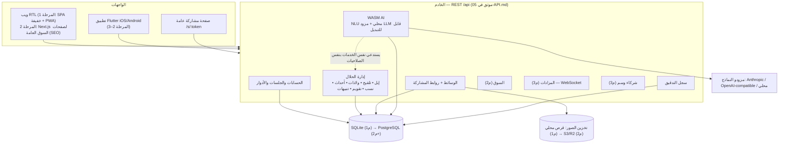
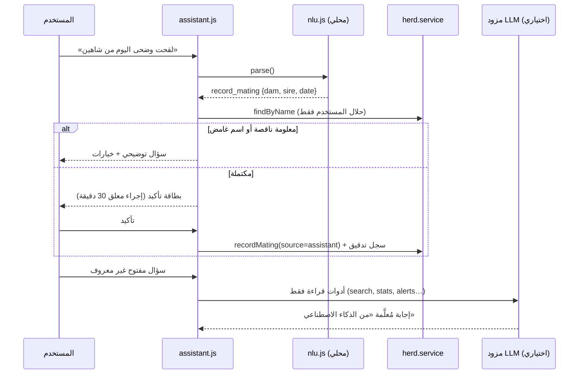

# 1. الخطة المعمارية التقنية — وسم | WASM

## 1.1 المبدأ الحاكم
الميزانية المتاحة 7,000 ريال قطري لا تكفي لبناء كل الميزات بالتقنيات الكاملة (Flutter + Next.js + NestJS + PostgreSQL + WebSockets). لذلك قسّمنا البنية إلى **نواة نظيفة** تُبنى الآن، و**حدود واضحة (Modules)** تُضاف إليها المراحل اللاحقة دون إعادة بناء.



## 1.2 ما تم بناؤه فعلياً في المرحلة الأولى
| الطبقة | التقنية الحالية | السبب |
|---|---|---|
| الخادم | Node.js 22 بدون أي مكتبة خارجية (`node:http`, `node:sqlite`, `node:crypto`) | صفر اعتماديات = صفر ثغرات من سلسلة التوريد، تشغيل على أرخص خادم، لا خطوة بناء |
| قاعدة البيانات | SQLite (WAL) | مجانية، نسخ احتياطي بنسخ ملف واحد، تكفي آلاف المستخدمين في المرحلة الأولى |
| الواجهة | HTML/CSS/JS بدون إطار، RTL، PWA | تحميل سريع على شبكات الجوال، لا تكلفة بناء، قابلة للتثبيت على الجوال كتطبيق |
| الذكاء الاصطناعي | فاهم لغة خليجي محلي + واجهة مزودين قابلة للتبديل | العمليات الحساسة (تسجيل/استعلام) لا تعتمد على نموذج قد "يهلوس"، وتكلفة API صفرية حتى يُفعّل المزود |
| الاختبارات | `node:test` — 18 مجموعة اختبار | بدون مكتبات |

## 1.3 التعديلات على التقنيات المقترحة (ولماذا)
| المقترح | القرار | السبب |
|---|---|---|
| NestJS | **مؤجل للمرحلة 2** | الكود الحالي مقسّم بنفس فلسفة NestJS (خدمات مستقلة عن HTTP)؛ نقل `herd.service.js` إلى Nest Module عمل ميكانيكي. البدء بـ Nest الآن يستهلك الميزانية في الإعداد لا في الميزات. |
| PostgreSQL | **المخطط جاهز ومُختبر** (`db/postgres/001_schema.sql`، 40 جدولاً، مع RLS) | التشغيل الحالي على SQLite لتوفير تكلفة خادم قاعدة البيانات المُدار (~100–250 ر.ق شهرياً). الاستعلامات مكتوبة بـ SQL قياسي. |
| Next.js | **للمرحلة 2 فقط لصفحات السوق العامة** | إدارة الحلال صفحات خاصة خلف تسجيل الدخول ولا تحتاج SEO. السوق يحتاج SEO → Next.js هناك منطقي. |
| Flutter | **أبقيناه للتطبيقات، مع PWA أولاً** | الويب الحالي قابل للتثبيت على الجوال. Flutter يُبنى عندما يوجد مستخدمون فعليون يبررون تكلفة متجري Apple/Google. |
| WebSockets | **المرحلة 3 مع المزادات** | لا حاجة له في إدارة الحلال؛ التنبيهات تُحسب عند الطلب. |
| بنية AI مستقلة | **منفذة الآن** (`server/modules/ai/providers.js`) | تبديل المزود بمتغير بيئة `AI_PROVIDER`. |

## 1.4 تقسيم الوحدات (Modules) — حدود ثابتة عبر المراحل
```
server/
  lib/            ← البنية المشتركة: db, http, auth, audit, util
  modules/
    herd.service.js    ← منطق الحلال (لا يعرف شيئاً عن HTTP)
    media.service.js   ← الصور والمستندات وروابط المشاركة
    ai/                ← nlu.js (فهم اللغة) • assistant.js (المنسق) • providers.js (المزودون)
    market/      (م2)  ← listings, offers, favorites, reports
    auctions/    (م3)  ← auctions, bids (WebSocket), bid_alerts
    partners/    (م3)  ← companies, campaigns, codes, referrals, contracts
    admin/       (م3)  ← لوحة الإدارة وصلاحيات مدير الدولة
  routes.js       ← طبقة HTTP رفيعة فقط
```
القاعدة: **المساعد الذكي لا يملك صلاحيات خاصة** — يستدعي نفس دوال الخدمات التي يستدعيها الـ API، مقيدة بـ `owner_id` للمستخدم الحالي.

## 1.5 تدفق المساعد الذكي


## 1.6 خطة التوسع
- **حتى ~5,000 مستخدم:** خادم واحد (2 vCPU / 4GB) + SQLite + نسخ احتياطي يومي.
- **المرحلة 2:** PostgreSQL مُدار + تخزين R2/S3 + CDN للصور + Redis للجلسات وتحديد المعدل.
- **المرحلة 3:** فصل خدمة المزادات (WebSocket) أفقياً عبر Redis Pub/Sub؛ معالجة المزايدة داخل معاملة `SERIALIZABLE` مع قفل الصف وسلسلة تجزئة للسجل.
- **المرحلة 4:** طابور مهام (BullMQ) لتحليل الصور والتثمين والإشعارات؛ نسخة قراءة من القاعدة للتقارير.

## 1.7 المراحل 2–4 (منفذة)
- **وحدات جديدة:** `market.service.js` (السوق والعروض والرسائل والصفقات والتوصيات والتثمين)، `auction.service.js`، `partner.service.js` (الشركاء والوسطاء)، `community.service.js` (المجتمع والمزاين)، `admin.service.js`، و`scheduler.js` (مهام كل 15 ثانية).
- **البث المباشر:** Server-Sent Events بدل WebSockets. السبب: المزايدة تُرسل بطلب POST يُتحقق منه على الخادم، والبث مطلوب في اتجاه واحد فقط (سعر جديد، تمديد، إشعار)، وSSE يعمل بلا مكتبات وعبر البروكسيات. للتوسع على عدة خوادم: Redis Pub/Sub.
- **سلامة المزايدة:** `BEGIN IMMEDIATE` يسلسل الكتابات فلا تُقبل مزايدتان بنفس المبلغ، سجل `bids` إلحاقي بمحفزات تمنع التعديل والحذف، وكل مزايدة تحمل تجزئة السابقة (`/verify`).
- **الصلاحيات:** مدير عام لكل الدول، ومدير دولة مقيد بدولته في كل مسارات الإدارة (مُختبر).
