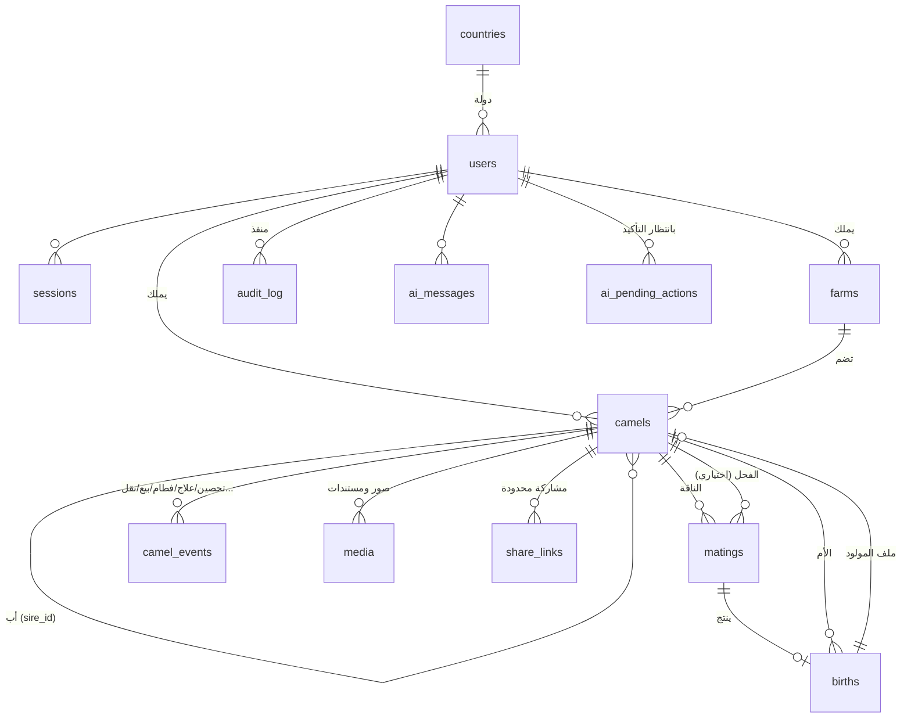

# 2. قاعدة البيانات والعلاقات

- **التشغيل الحالي:** `server/migrations/001_init.sql` (SQLite) — جداول المرحلة الأولى.
- **المخطط المستهدف للإنتاج:** `db/postgres/001_schema.sql` — 40 جدولاً للمراحل 1→4، **تم تنفيذه واختباره على PostgreSQL** ويشمل: أنواع ENUM، قيود سلامة، فهارس بحث عربي (pg_trgm)، أمان على مستوى الصفوف (RLS)، وقواعد تمنع تعديل/حذف سجل التدقيق والمزايدات.

## 2.1 مخطط العلاقات — المرحلة الأولى

## 2.2 الجداول الأساسية
| الجدول | الغرض | أهم الحقول والقيود |
|---|---|---|
| `users` | الحسابات | `role` ∈ 8 أدوار؛ `gestation_days` (330–420، الافتراضي 390)؛ `birth_alert_days`؛ موافقات منفصلة لتدريب AI ومشاركة الشركاء (معطلة افتراضياً)؛ قفل بعد 5 محاولات |
| `camels` | الملف الرقمي لكل مطية | `dam_id`/`sire_id` ذاتية الإشارة لشجرة النسب؛ `dam_name_text`/`sire_name_text` لآباء خارج الحلال؛ `pedigree_verified` افتراضياً FALSE؛ وسم فريد لكل مالك؛ `name_norm` للبحث العربي |
| `matings` | التلقيح | `expected_birth_date` = التاريخ + مدة الحمل (تقديري)؛ `outcome` (بانتظار/خلفة مؤكد/ما لقحت/ولدت/إجهاض)؛ فحل من الحلال أو اسم نصي؛ `source` (يدوي/المساعد) |
| `births` | الولادات | ترتبط بالتلقيح وتنشئ ملف المولود تلقائياً وتربطه بالأم والأب |
| `camel_events` | الفطام، التحصين، العلاج، الزيارات البيطرية، البيع، الشراء، النقل، الفحص، الإنجازات | `next_due_date` يغذي التقويم والتنبيهات |
| `media` | الصور والمستندات | تخزين خارج القاعدة؛ `sha256` لاكتشاف المكرر |
| `share_links` | مشاركة محدودة | الرمز مخزن كتجزئة فقط؛ نطاق + انتهاء + إلغاء + عداد |
| `audit_log` | سجل تدقيق وسجل تعديلات كل مطية | الفروقات (قبل/بعد) بصيغة JSON |
| `ai_pending_actions` | إجراءات المساعد بانتظار التأكيد | صلاحية 30 دقيقة، تنفيذ ذري يمنع التكرار |

## 2.3 قواعد سلامة البيانات المطبقة في الكود
1. الأم يجب أن تكون ناقة والأب فحلاً، ومن حلال نفس المالك.
2. منع الحلقات في شجرة النسب (استعلام تكراري `WITH RECURSIVE`).
3. لا تاريخ ميلاد أو تلقيح أو ولادة في المستقبل، ولا ولادة قبل تاريخ التلقيح.
4. تلقيح جديد يُغلق التلقيح السابق "بانتظار التأكيد" (ولا يمس الخلفة المؤكدة — يحذّر المساعد بدلاً من ذلك).
5. البيع/النقل يغيّر الحالة ويُخرج المطية من الحلال النشط والتنبيهات.
6. كل عملية كتابة تُسجل في `audit_log`.

## 2.4 جداول المراحل القادمة (موجودة في مخطط PostgreSQL)
- **م2:** `listings`, `listing_favorites`, `offers`, `reports`, `conversations`, `messages`, `ai_image_analyses`, `notifications`, `devices`
- **م3:** `auctions` (مع `anti_snipe_seconds` و`version`)، `bids` (إلحاقي فقط + سلسلة تجزئة)، `bid_alerts`، `deals`، `companies`، `ad_packages`، `campaigns`، `campaign_stats_daily`، `discount_codes`، `referrals`، `sponsorship_contracts`، `payments`، `admin_country_scopes`
- **م4:** `valuation_samples`، `festivals`، `festival_results`، `posts`

## 2.5 جداول المراحل 2–4 في التشغيل الحالي
`server/migrations/002_phases_2_4.sql`: `settings`, `listings`, `listing_favorites`, `offers`, `reports`, `conversations`, `messages`, `notifications`, `auctions`, `bids` (إلحاقي + سلسلة تجزئة)، `auction_watchers`, `ai_alerts`, `deals`, `broker_profiles`, `companies`, `company_offerings`, `ad_packages`, `campaigns`, `discount_codes`, `code_redemptions`, `referrals`, `sponsorship_contracts`, `posts`, `post_comments`, `post_likes`, `festivals`, `festival_results`, `search_log` — المجموع 43 جدولاً.
